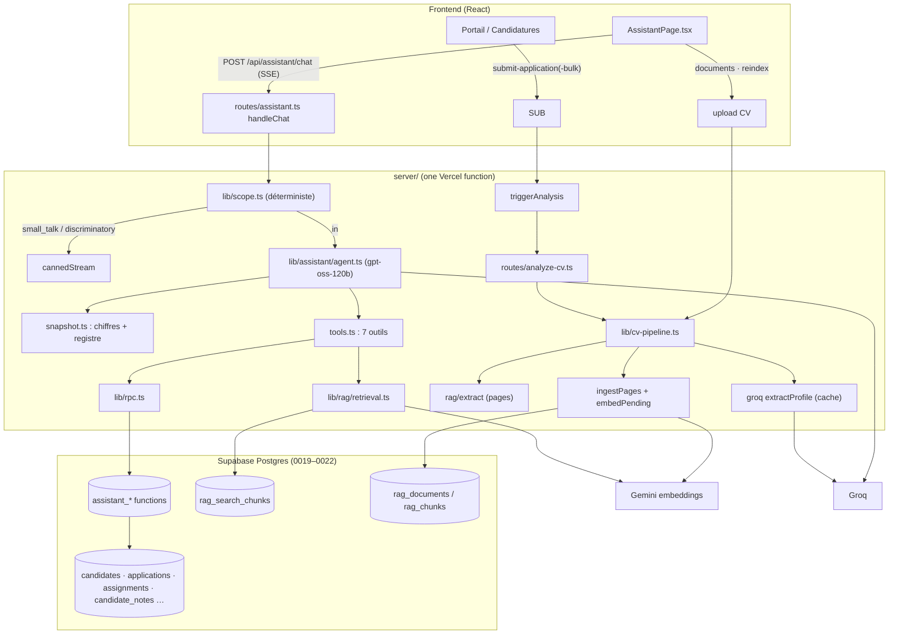

# Assistant analysis — personal recruiting assistant (v2)

Analysis of the recruiting assistant ("Assistant IA PHOSBOUCRAA / OCP stages") after its rebuild, branch `feat/assistant-v2` (October 2026).

> Earlier versions of this document are in git: the pre-rebuild RAG at `1d2ff23`, the audit of the hybrid RAG at `bc08568`.

## TL;DR

**What it is.** A personal assistant for recruiters. It knows every candidate, their CV, their applications and results, the offers and assignments, and the notes the team asked it to remember. It answers from that data, cites CV pages, and says when something is not in the data.

**Why it was rebuilt.** In production it answered "aucun candidat" with 7 candidates in the database, "aucun CV" while every candidate had one, and refused "Quelle université de Babtich El Habib ?" as off-topic. Root causes:
- the agent could only *search words*; it had no way to count, list or open a candidate's file;
- CVs from applications (`candidates.cv_text`) never reached its knowledge base, which only held manual uploads;
- an LLM scope classifier produced false refusals.

**How it works now.**
- **One CV pipeline** (`server/lib/cv-pipeline.ts`): every CV — portal application, bulk import, upload from the assistant — is read page by page, analysed by Groq (identity, skills, education, and a detailed profile: summary, experiences, projects, languages, certifications), and indexed **under its candidate's name**.
- **Snapshot every turn**: key counts and one line per candidate (up to 40) are given to the model, so volume and list questions need no tool.
- **Seven tools** backed by SQL functions: `get_candidate` (full file), `search_cvs`, `find_candidates`, `rank_candidates`, `list_offers`, `list_bookings`, `save_note`.
- **Hybrid search** over CV chunks: Postgres full-text ∪ pgvector cosine (Google `gemini-embedding-2`, 768 dimensions), fused with RRF; neighbouring chunks merged; optional per-candidate scope.
- **Deterministic scope filter**: greetings get a fixed reply; discriminatory ranking requests are refused; everything else goes to the agent.

**Stack.** Vercel only (one Node function, `server/` bundled into `api/_handler.cjs`), Supabase Postgres, Groq `gpt-oss-120b` (agent) / `gpt-oss-20b` (CV extraction), Gemini embeddings.

---

## 1. Architecture

---

## 2. Files

### Assistant — `server/lib/assistant/`

| File | Role |
|---|---|
| `agent.ts` | Agent loop: system prompt + snapshot + history, streaming, parallel tools per round, 4 rounds + forced final round, citation check, provider failures (`FALLBACK_ANSWER`, `QUOTA_ANSWER` on 429) |
| `prompt.ts` | `SYSTEM` (grounding, people, answer format, memory, safety) and the 7 tool schemas |
| `snapshot.ts` | `buildSnapshot`: `assistant_overview` + `assistant_roster` formatted as text |
| `tools.ts` | Tool handlers, argument validation, `resolveCandidate` (one person, or the list of possible people) |
| `__fixtures__/seed.sql` | Synthetic data set for tests and evaluation |
| `__tests__/` | RPCs, tools, agent and end-to-end tests on PGlite |

### RAG — `server/lib/rag/`

| File | Role |
|---|---|
| `extract.ts` | Text page by page (unpdf, mammoth, plain text) |
| `chunking.ts` | ~900-char chunks, cut before headings, heading "Title › Section", `documentTitle` |
| `embeddings.ts` | Gemini client (`batchEmbedContents`, 768 dims, query/document prefixes) |
| `ingest.ts` | `ingestPages` (with candidate link), `embedPending`, `cvDocumentName`, `cvTitle` |
| `retrieval.ts` | `retrieveDocChunks` (optional candidate scope), `mergeAdjacent` |
| `store.ts`, `context.ts`, `debug.ts`, `config.ts`, `types.ts` | Storage interface, tool-result budget, `RAG_DEBUG` traces, tunables, shared types |

### Around them

| File | Role |
|---|---|
| `server/lib/cv-pipeline.ts` | `analyzeApplication`, `indexCandidateCv`, `createCvApplication`, `reindexAll` |
| `server/lib/rpc.ts` | `rpc(fn, args)`; Supabase in production, PGlite in tests (`setRpcClient`) |
| `server/lib/scope.ts` | Small talk, discriminatory backstop, `cannedStream` |
| `server/lib/conversations.ts` | History from the database, with a `[contexte : …]` note per assistant turn |
| `server/lib/internal-auth.ts` | `CRON_SECRET` check for `/api/analyze-cv` and `/api/rag-embed` |
| `server/routes/assistant.ts` | Chat (SSE), documents, `POST /api/assistant/reindex`, conversations |
| `server/scripts/eval-rag.ts`, `reindex.ts` | Live evaluation; reindex against `.env` |

---

## 3. Data model and SQL

| Object | Migration | Role |
|---|---|---|
| `candidates.profile`, `profile_updated_at` | 0021 | Structured CV profile (FR): summary, experiences, education, projects, languages, certifications |
| `rag_documents.candidate_id`, `title` | 0021 | A CV belongs to a candidate; display title « CV — Prénom Nom » |
| `candidate_notes` | 0021 | Recruiter notes (`source` ui / assistant, author, date) |
| `rag_chunks.embedding vector(768)` | 0022 | Gemini vectors; HNSW cosine index |
| `assistant_overview()` | 0021 | Counts: candidates, indexed CVs, applications by status, offers, assignments, notes |
| `assistant_roster(limit)` / `assistant_candidate_rows()` | 0021 | One line per candidate: education, top skills, last application and status, assignment, notes, CV indexed |
| `assistant_resolve_candidate(q)` | 0021 | Id (`#12`), e-mail, or name (particles ignored, trigram similarity ≥ 0.5) |
| `assistant_candidate_dossier(id)` | 0021 | Identity, profile, skills, applications with timeline and assignment (`score_breakdown`), switch requests, notes, CV documents |
| `assistant_find_candidates(...)` | 0021 | Free text + field, skills (all), education, status, offer, experience |
| `assistant_offers`, `assistant_bookings`, `assistant_ranking_pool`, `assistant_save_note` | 0021 | Offers (with detail), confirmed bookings in a window, ranking input, note insert |
| `rag_search_chunks` v3 | 0021 | Hybrid FTS ∪ vector, RRF; `p_candidate_id`; unfiltered vector branch uses HNSW (checked by `EXPLAIN` in tests) |

All functions are `security definer` and executable by `service_role` only; the API checks the caller's role itself. No views: a view would be exposed by Supabase's REST API.

---

## 4. Flows

### 4.1 A CV comes in
1. Portal application, bulk import, or upload in the assistant (`doc_type` CV, or a file name with cv/resume) → file in Storage → candidate + application (`createCvApplication`; no offer = spontaneous application) → `triggerAnalysis` → `/api/analyze-cv`.
2. `analyzeApplication`: text page by page → `extractProfileCached` (gpt-oss-20b, cached by text hash + `EXTRACTION_VERSION`) → identity reconciliation (a placeholder candidate whose CV e-mail already exists is merged into the existing one) → candidate updated (education, university, experience, phone, `profile`) → skills replaced.
3. `indexCandidateCv`: `ingestPages("cv-candidat-<id>", pages, "cv", replace, { candidateId, title: "CV — Nom", headingTitle: "Nom" })` → `embedPending(400)` right away (the daily Cron catches up on failure) → best match score.

### 4.2 A question comes in
1. `POST /api/assistant/chat` (staff, 60 questions/hour) → history (12 messages, with `[contexte : …]` notes).
2. `classifyScope`: small talk → fixed reply; protected attribute + selection verb → refusal; otherwise the agent.
3. Agent: `SYSTEM` + snapshot + history → `gpt-oss-120b` (temperature 0.2) → tools in parallel → tool results capped at 8000 characters → answer streamed (SSE: `conversation`, `tool`, `delta`, `sources`, `done`).
4. Sources shown under the answer: candidate file card, saved note, candidate list, ranking, CV extracts with page.

### 4.3 Search in CVs (`search_cvs`)
Query embedded as `task: search result | query: …` (4 s timeout, falls back to full-text) → `rag_search_chunks(q, vector, top_k, null, 0.02, MIN_COSINE, 60, candidate_id)` → neighbouring chunks of the same page merged → extracts tagged `contenu_non_fiable`.

---

## 5. Parameters

| Parameter | Value | Where |
|---|---|---|
| Chunks | 900 / 150 chars; cut before a heading; heading "Nom › Section" | `rag/config.ts`, `chunking.ts` |
| Embeddings | `gemini-embedding-2`, 768 dims, batches of 32, 2 retries, 15 s (4 s for a question) | `rag/config.ts` |
| Fusion / floors | RRF k = 60; FTS ≥ 0.02; cosine ≥ **0.6 (provisional)** | `rag/config.ts` |
| top-k | 5 by default, 20 max, counted in chunks before merging | `rag/config.ts` |
| Snapshot | full roster up to 40 candidates | `assistant/snapshot.ts` |
| Agent | 4 tool rounds + 1 final, temperature 0.2, history 12 × 4000 chars, tool result ≤ 8000 chars | `rag/config.ts` |
| Name resolution | similarity ≥ 0.5; ambiguous if the top two are within 0.2 | 0021, `assistant/tools.ts` |
| Background routes | `maxDuration` 300 s; daily Cron `/api/rag-embed` at 04:00 | `vercel.json` |

---

## 6. Environment variables

| Variable | Purpose |
|---|---|
| `SUPABASE_URL`, `SUPABASE_SERVICE_ROLE_KEY` | Database, Storage |
| `GROQ_API_KEY` (`GROQ_MODEL`, `GROQ_EXTRACT_MODEL`) | Agent and CV extraction |
| `GEMINI_API_KEY` | Embeddings; without it, CV search is full-text only |
| `CRON_SECRET` | Protects `/api/analyze-cv` and `/api/rag-embed`; sent by Vercel Cron |
| `RAG_DEBUG=1` | Traces: scope, prompts per round, search rows with scores, fallback cause |

---

## 7. Tests and evaluation

- `npm test`: about 350 API tests. The assistant's SQL functions, tools and an end-to-end flow run on **PGlite with every real migration**, the synthetic seed and indexed CVs — no Supabase, no mocks of SQL. Migration 0021/0022 replay and the HNSW plan are tested.
- `npm run eval:rag`: 31 labelled cases through the real model, the whole database in PGlite. Every question of the failing production transcript is a case; others cover counts, candidate files and results, filters, CV facts across chunks, follow-ups, memory across conversations, ambiguous and unknown names, missing facts, scope and injection. `--only`, `--category`, `--compare`, `--out`.

---

## 8. Open problems and recommendations

Severity: 🔴 high · 🟠 medium · 🟡 low.

### 🔴 1. Groq's daily token quota
`gpt-oss-120b` is capped at 200,000 tokens per day on the free tier. A question costs about 4,000–15,000 tokens (system prompt, snapshot and tool schemas are resent every round), so the budget covers roughly 15–50 questions per day for everyone, and a full evaluation run uses most of it. When it runs out, users get `QUOTA_ANSWER`. **Recommendation:** Groq Dev tier, or route simple questions to `gpt-oss-20b`.

### 🟠 2. Vector search not yet calibrated
`MIN_COSINE = 0.6` is a starting value for Gemini. Run `npm run eval:rag` with `GEMINI_API_KEY` and adjust it from the scores seen in `RAG_DEBUG` traces.

### 🟠 3. The snapshot stops at 40 candidates
Beyond 40, only counts are shown and the model must call `find_candidates` for lists. Fine for a yearly intake; revisit if the candidate base grows a lot.

### 🟠 4. Notes have no screen of their own
Notes saved by the assistant appear in its answers and in `assistant_candidate_dossier`, but the candidate page does not show `candidate_notes` yet, and the assistant cannot edit or delete one.

### 🟡 5. Off-topic questions cost a model call
With the classifier gone, the agent itself refuses off-topic questions (no tools, one call). Cheap in a staff-only tool, but it counts against the quota.

### 🟡 6. Concurrent embedding runs repeat work
Two uploads close together can embed the same pending chunks twice. Results stay correct. Fix: claim rows with `FOR UPDATE SKIP LOCKED`.

### 🟡 7. Citation check covers file names only
`unverifiedCitations` checks names ending in `.pdf`/`.docx`/`.txt`/`.md`; a cited « CV — Nom » title is not checked.

### 🟡 8. Extraction gaps
No OCR (a scanned PDF fails with "Aucun texte extrait"); DOCX files have no page numbers; single-word title-case headings ("Formation") are not detected — the candidate's name still labels every chunk.

### 🟡 9. Name resolution is heuristic
Trigram similarity ≥ 0.5 can match a different person with a close name; the 0.2 margin rule then asks which one. Unusual spellings may need the candidate id (`#12`).
